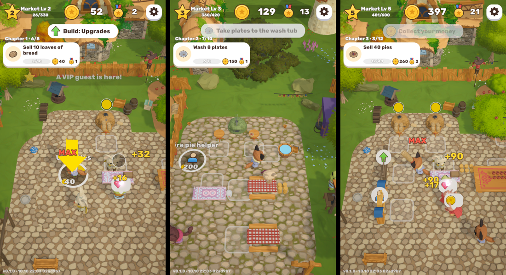
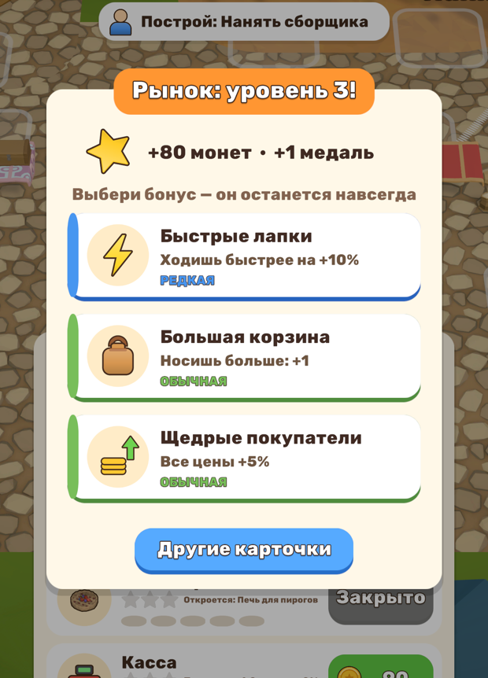
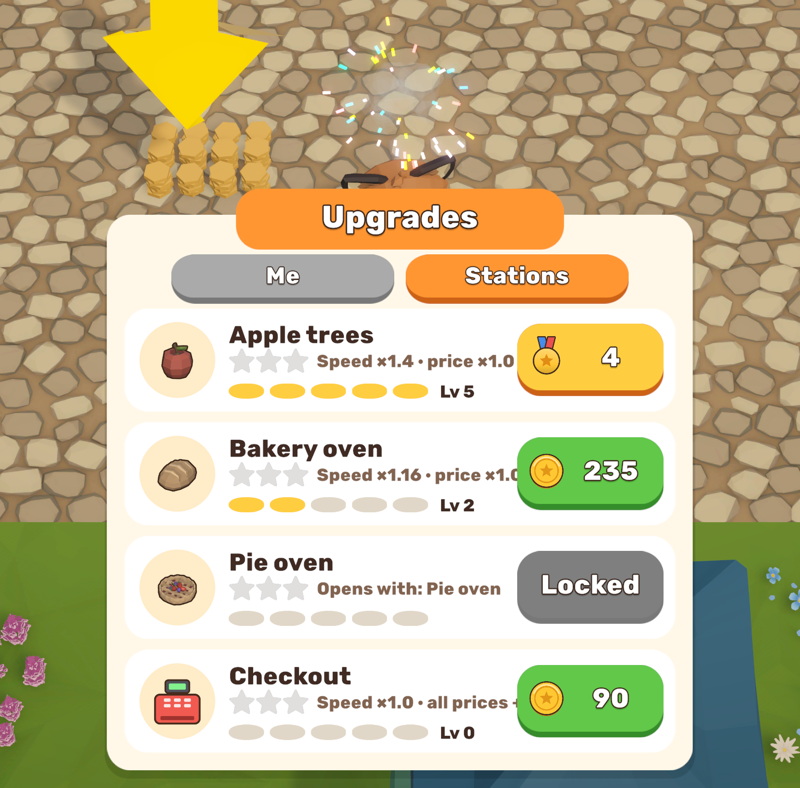

# Village Market

**Уютная игра про свой рынок в сказочной деревне.** Собирай яблоки, пеки хлеб и пироги, обслуживай покупателей и превращай маленький прилавок в самый шумный рынок округи.

### [⬇ Скачать для Windows](https://github.com/bblazeAl/village-market/releases/latest/download/VillageMarket-Windows.zip) · [⬇ Скачать для Android](https://github.com/bblazeAl/village-market/releases/latest/download/VillageMarket-Android.apk)

*English version below.*

## Об игре

Ты — лисичка-торговка. Утром у тебя только горсть монет и пустая площадь, а впереди — целый рынок. Срывай яблоки с яблонь, раскладывай их на прилавок и рассчитывай покупателей на кассе. На заработанное ставь новые прилавки, сажай сад, разжигай хлебные печи и открывай террасу, где гости лакомятся яблочными пирогами.

Покупатели — кролики, котики, лягушки, енотики и другие зверята — приходят со своими желаниями. Не заставляй их ждать: нетерпеливые уходят ни с чем, а довольные радуются, оставляют чаевые и возвращаются снова. Иногда на рынок заглядывает VIP-гость в короне и платит втрое.

Когда дела пойдут в гору, найми помощников: кассира, сборщика яблок, пекаря и официанта для террасы. Они работают за тебя — даже пока тебя нет в игре.

## Особенности

- 🍎 **Яблоки, хлеб и пироги** — три товара и целая цепочка: из яблок пекутся пироги, пироги едят за столиками, грязные тарелки — в мойку.
- 🏗 **Расти рынок** — больше 20 построек: яблони, печи, прилавки, столики, терраса.
- 🦊 **Помощники** — нанимай и улучшай работников, чтобы рынок работал сам.
- 📜 **Задания и главы** — истории рынка в трёх главах с сундуками наград и бесконечные заказы после них.
- ⭐ **Звёзды станций** — улучшай яблони, печи и кассу, получай звёзды, и твой товар станет дороже.
- 🃏 **Бонус на каждом уровне** — выбирай одну карточку из трёх: обычную, редкую или эпическую. Бонус остаётся навсегда.
- 🎮 **Просто играть** — управление одним пальцем, подсказки всегда покажут, куда идти дальше.
- 🇷🇺 🇬🇧 **Русский и английский язык.**

| Выбери бонус | Улучшай станции |
|---|---|
|  |  |

## Как установить

**Windows.** Скачай [архив](https://github.com/bblazeAl/village-market/releases/latest/download/VillageMarket-Windows.zip), распакуй папку целиком и запусти `VillageMarket.exe`. Если Windows покажет окно «Система Windows защитила ваш компьютер», нажми «Подробнее» → «Выполнить в любом случае».

**Android (8 и новее).** Скачай [файл игры](https://github.com/bblazeAl/village-market/releases/latest/download/VillageMarket-Android.apk) на телефон и открой его. Разреши установку из этого источника, а на предупреждении Google Play Защиты нажми «Всё равно установить».

**Управление:** зажми экран в любом месте и веди пальцем (на компьютере — мышкой или клавишами WASD). Чтобы построить, встань на круг с ценой; чтобы улучшить, встань на доску. Язык — в настройках (шестерёнка).

Все версии — на странице [Releases](https://github.com/bblazeAl/village-market/releases).

## Авторы

Игра — Alena ([bblazeAl](https://github.com/bblazeAl)).

3D-графика и эффекты — [Synty Studios](https://syntystudios.com). Анимации — [Quaternius](https://quaternius.com). Звуки — [Kenney](https://kenney.nl). Музыка — neonarkade и MintoDog ([OpenGameArt](https://opengameart.org)). Шрифт — [Rubik](https://github.com/googlefonts/rubik).

---

# Village Market (English)

**A cozy game about running your own market in a fairy-tale village.** Pick apples, bake bread and pies, serve your customers and turn a tiny stall into the busiest market around.

### [⬇ Download for Windows](https://github.com/bblazeAl/village-market/releases/latest/download/VillageMarket-Windows.zip) · [⬇ Download for Android](https://github.com/bblazeAl/village-market/releases/latest/download/VillageMarket-Android.apk)

You are a fox shopkeeper with a handful of coins and an empty square. Pick apples, stock the stall and ring up customers at the till. Spend your earnings on new stalls, an orchard, bakery ovens and a terrace where guests enjoy apple pie. Bunnies, cats, frogs, raccoons and other villagers come with their own wishes — keep them happy and they'll tip and come back; now and then a VIP guest in a crown pays triple. When business booms, hire a cashier, an apple picker, a baker and a terrace helper who keep working even while you're away.

**Features**
- 🍎 Apples, bread and pies — a full chain from orchard to oven to table (and the dishes after).
- 🏗 20+ buildings to unlock: trees, ovens, stalls, tables, a terrace.
- 🦊 Helpers you can hire and upgrade.
- 📜 Quests in three chapters with reward chests, then endless market orders.
- ⭐ Station stars: upgrade trees, ovens and the till to sell for more.
- 🃏 A bonus on every level: pick one of three cards — common, rare or epic — and keep it forever.
- 🎮 One-finger controls and hints that always show where to go next.
- 🇬🇧 🇷🇺 English and Russian.

**Install.** Windows: unzip the whole folder and run `VillageMarket.exe` (on the SmartScreen warning: "More info" → "Run anyway"). Android 8+: open the APK on your phone, allow installs from this source and install.

**Controls:** hold and drag anywhere (mouse or WASD on PC). Stand on a price circle to build, on a board to upgrade.

**Credits:** game by Alena. 3D art and effects by Synty Studios, animations by Quaternius, sounds by Kenney, music by neonarkade and MintoDog (OpenGameArt), Rubik font.

---

Сделано на Unity 6. Модели Synty распространяются только внутри сборок игры. © 2026 Alena, все права защищены.
